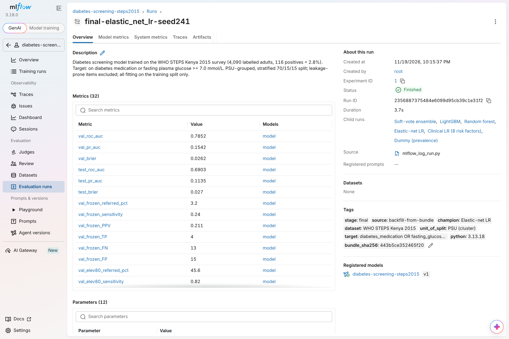
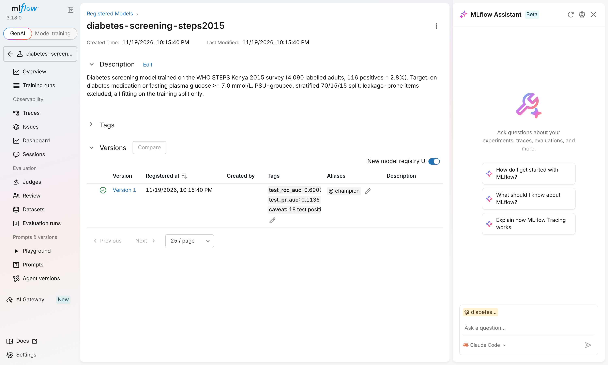

# Diabetes Screening API: WHO STEPS Kenya 2015

FastAPI service + built-in test page for the elastic-net diabetes classifier from `Diabetes Classifier STEPS2015.ipynb`.
The notebook and data (`Kenya2015.csv`) sit at the project root; the service code, model files, scripts and tests are in `deploy/`.
Paths below such as `app/`, `model/`, `scripts/`, `tests/` and `docs/` are relative to `deploy/`.
The model scores an adult from cheap, non-laboratory inputs (age, sex, residence, body measurements, blood pressure, a few history answers) and returns the
**calibrated probability of diabetes** (fasting glucose ≥ 7.0 mmol/L or on treatment) and whether it crosses the frozen referral threshold.

> **Research prototype, not a diagnostic device.** Held-out ROC-AUC is ≈ 0.69 (validation 0.79) from only 17-18 positives per set. See "What the model can and cannot do".

## 1. Run it (60 seconds)

**Docker (recommended)**
```bash
docker compose up --build          # run from the project root; then open http://localhost:8000
```
**Without Docker** (must use the pinned versions: the model file is a pickle tied to scikit-learn 1.6.1 / pandas 2.2.3 / numpy 2.1.0)
```bash
python -m venv .venv && source .venv/bin/activate      # Windows: .venv\Scripts\activate
pip install -r requirements-dev.txt                     # full environment: notebook + API + MLflow + tests
cd deploy
uvicorn app.main:app --port 8000                        # then open http://localhost:8000
pytest -q tests                                         # 17 tests (API, parity, MLflow registry)
```
`deploy/requirements.txt` holds only the API's runtime dependencies (used by the Docker image); `deploy/requirements-mlflow.txt` adds MLflow.
| URL | What |
|---|---|
| `/` | **Test page** (forms, example people, gauge, explanation of the score) |
| `/docs` | Interactive OpenAPI (Swagger) for every endpoint |
| `POST /predict` | Score one person |
| `POST /predict/batch` | Score up to 200 people |
| `GET /model-info`, `/schema`, `/health` | Metrics + limitations, allowed inputs, liveness |

```bash
curl -s -X POST http://localhost:8000/predict -H "content-type: application/json" -d '{
  "age": 62, "sex": "female", "residence": "urban",
  "height_cm": 156, "weight_kg": 88, "waist_cm": 112, "hip_cm": 114,
  "systolic_bp": 158, "diastolic_bp": 96, "heart_rate": 90,
  "on_bp_medication": true, "bp_ever_measured": true, "told_raised_bp": true }'
```
Only `age`, `sex`, `residence` are required. Any other STEPS item can be passed as `"extra_items": {"D8": 3}` (see `/schema`). Items that define or reveal the label
(glucose `B5`, diabetes medication/history `H6`-`H11`, advice `H20*`, lab block, IDs) are **rejected on purpose** (HTTP 422).

## 2. How serving stays identical to training
* `app/engine.py` contains the notebook's own `apply_structural / build_features / finalize` code, driven by the metadata saved with the model
  (`model/meta.json`, produced by `scripts/reproduce_reference.py`). Cleaning, skip-logic fills, engineered features and the scikit-learn pipeline are therefore the same objects.
* `tests/test_api.py::test_engine_matches_notebook_exactly` re-scores 60 held-out respondents and requires the notebook's probabilities to match to 1e-9 (they match exactly).
* `scripts/reproduce_reference.py` re-executes the notebook's data-preparation cells and confirms the bundle reproduces `model_card.json`
  (validation ROC-AUC 0.7852 / PR-AUC 0.1542, test 0.6903 / 0.1135): **verified**.

## 3. What the model can and cannot do (read before showing it to anyone)
| Fact | Evidence |
|---|---|
| Discrimination is moderate | test ROC-AUC 0.69 (CI wide), validation 0.79 |
| Age + sex alone rank almost as well as everything | on 1,233 held-out people: ROC-AUC 0.722 (age, sex, residence only) vs 0.734 (all items) |
| The frozen threshold 0.091 (assumed 10:1 cost of a miss vs a false alarm) is a **high-specificity** rule | test: refers 5% of people, sensitivity 0.33 (6 of 18), PPV 0.19 |
| Reaching ~80% sensitivity needs a much lower threshold | threshold 0.015 (from validation): refers ~50% of people; test sensitivity 0.72, PPV 0.04 |
| Few events | 81 train / 17 validation / 18 test positives, so every metric is imprecise |
| Probabilities are calibrated (Platt) to the survey's ~2.8% base rate | not to any other population |

The threshold is a **policy** choice: set `REFERRAL_THRESHOLD` in `docker-compose.yml` to change it without retraining. Whoever sets it should state the assumed cost ratio.

**Ethics / fairness note.** The trained model contains ethnicity and interview-language dummies (weights ≤ 0.04 vs 0.24 for age). The API never asks for them (they are treated as "unknown"),
but a retrained version should drop them entirely.

## 4. Deploying it for others to test live
1. **Quickest public demo: tunnel from your laptop.** `docker compose up`, then `cloudflared tunnel --url http://localhost:8000` (or `ngrok http 8000`) gives an HTTPS link to share.
2. **Container platforms (Render, Railway, Fly.io, Google Cloud Run, Azure Container Apps, AWS App Runner):** push this folder to GitHub and create a *Docker* web service pointing at the `Dockerfile`;
   port 8000; health check path `/health`; 512 MB RAM is enough (the model is 3 MB). Set `API_KEY` as a secret.
3. **A VM (e.g. Ubuntu on DigitalOcean/Azure/AWS):** install Docker, `git clone`, `docker compose up -d --build`, put **Caddy or nginx** in front for HTTPS (`caddy reverse-proxy --from your.domain --to localhost:8000`).
4. **Before exposing it to the internet:** set `API_KEY` (clients send `X-API-Key`), keep HTTPS on, and add rate limiting at the proxy. The service **does not store inputs** and logs only the decision and probability.
   Health data are personal data: if you ever log or store requests, Kenya's Data Protection Act 2019 applies (consent, purpose limitation, minimisation).

## 5. Experiment tracking and model registry (MLflow)
MLflow records **what was trained, with which settings, how it scored, and which version is serving**. The API image does not contain MLflow; it is an optional second container.



| What | How |
|---|---|
| **Start the tracking server** (UI at http://localhost:5000) | `docker compose --profile mlflow up --build -d` |
| **Record the packaged model** (parameters, val/test metrics, operating points, 6 child runs, artefacts, a signed model, registry version with alias `champion`) | `docker compose --profile mlflow --profile mlflow-jobs run --rm log-model` |
| **Same thing without Docker** | `pip install -r deploy/requirements.txt -r deploy/requirements-mlflow.txt`, then from `deploy/` run `python scripts/mlflow_log_run.py` (local store in `deploy/mlruns`; view with `mlflow ui --backend-store-uri sqlite:///mlruns/mlflow.db`) |
| **Log a live training run from the notebook** (every grid/random/Optuna candidate, top-10 as child runs, final metrics, the bundle) | paste `scripts/notebook_mlflow_cell.py` as the last notebook cell |
| **Watch the running API** (request count, referral rate, mean risk vs the training base rate, latency, share of low-information requests; recorded every 60 s) | starts automatically with the `mlflow` profile (`serving-monitor`); or `python scripts/log_serving_stats.py --api http://localhost:8000` |
| **Load the registered model anywhere** | `mlflow.pyfunc.load_model("models:/diabetes-screening-steps2015@champion")`, then `.predict(DataFrame)` with the same fields as `POST /predict` (pass whole-number optional fields such as `years_schooling` as floats) |



Design choices worth defending in the viva:
- **Parity is tested.** `tests/test_mlflow.py` registers the model into a temporary store, loads `@champion` and checks its predictions equal the API's for four payloads.
- **Aggregates only.** `GET /metrics-summary` returns counts, a risk histogram and latency, never inputs; the test asserts the exact key set. The counters are in memory, so the container runs **one** uvicorn worker.
- **Drift needs a real population.** A demo page is not a random sample of Kenyan adults, so `mean_risk_vs_training_base_rate` is only meaningful once the service sees the people it is meant to screen. Treat it as a tripwire, not a verdict.
- **The registry holds the same weights as `model/`** (checked by the `bundle_sha256` parameter), so promoting a retrained model is: log it, compare runs, move the `champion` alias, copy its bundle into `model/`, rebuild the image.
- The MLflow store is SQLite on a Docker volume: fine for a capstone and a single user; use Postgres plus object storage if several people will write to it.

## 6. Layout
```
app/engine.py      notebook preprocessing + scoring + per-person explanation
app/service.py     friendly JSON  ->  questionnaire frame; warnings; percentile; decision
app/schemas.py     Pydantic validation (physiological ranges, contradictions, leakage guard)
app/telemetry.py   aggregate-only serving counters behind GET /metrics-summary
app/main.py        FastAPI routes, optional API-key guard
app/static/        the test page (no external CDN: works offline)
mlops/             MLflow model definition (same Scorer as the API)
model/             model_bundle.joblib, model_card.json, meta.json, operating_points.json
scripts/           mlflow_log_run.py, notebook_mlflow_cell.py, log_serving_stats.py, reproduce_reference.py
tests/             API, parity and MLflow tests
requirements*.txt  API-only and MLflow dependency pins
(project root) Dockerfile / Dockerfile.mlflow / docker-compose.yml / .dockerignore / requirements.txt (API, for cloud deploys) / requirements-dev.txt (full environment) / pyproject.toml (FastAPI Cloud entry point)
```
**Verified:** both images build from the project root (`docker compose --profile mlflow build`); the API, MLflow server and serving monitor start healthy; `/health`, `/`, `/predict` and the leakage guard (HTTP 422) respond as documented; the `log-model` job registers a new `champion` version; `pytest -q tests` passes 17 of 17.

## 7. Retraining / changing the model
Re-run the notebook (and the MLflow cell), then copy the new `diabetes_model/model_bundle.joblib` and `diabetes_model/model_card.json` into `deploy/model/`, run `python scripts/reproduce_reference.py <notebook> <Kenya2015.csv> <bundle> <card>` (rewrites `meta.json` and prints a MATCH/MISMATCH check), regenerate `model/operating_points.json`, and run `pytest`.
**Always pin the same scikit-learn/pandas/numpy versions you trained with.**
# Diabetes-Screening
